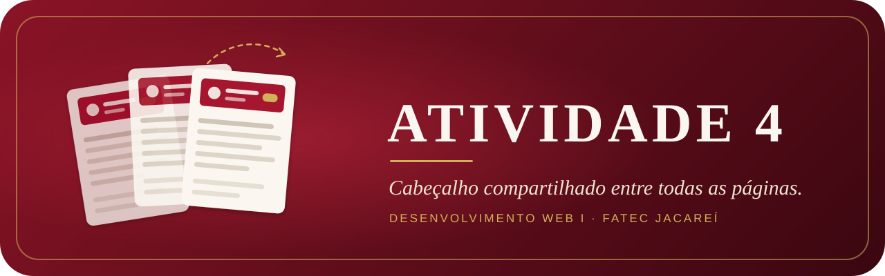
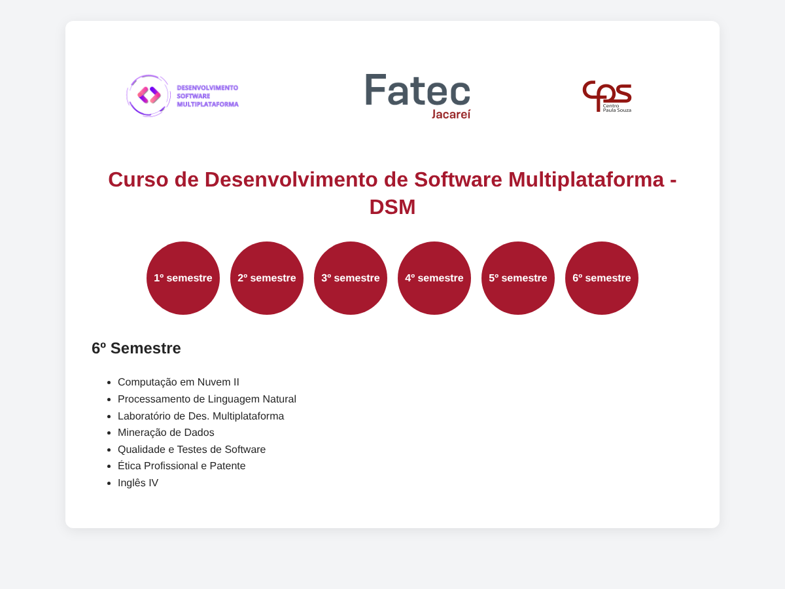
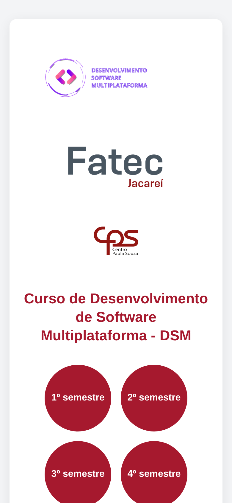
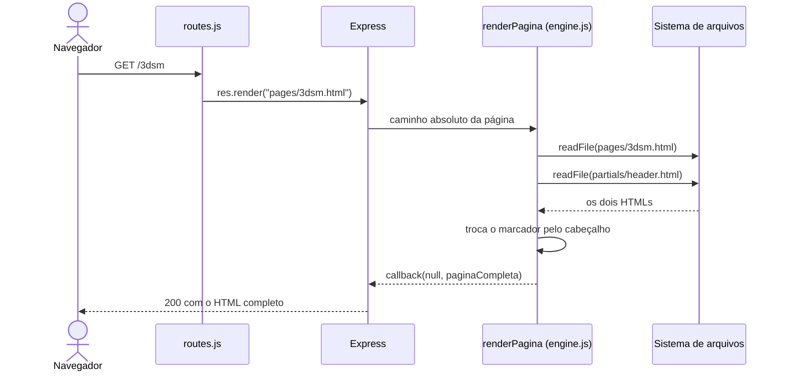

<div align="center">



**Site do curso de DSM da Fatec Jacareí servido por Express, com o cabeçalho escrito em um único arquivo e injetado em todas as páginas por uma view engine própria de 15 linhas.**


[Galeria](#-galeria) · [Como resolvi](#-como-resolvi-a-tarefa) · [Funcionalidades](#-funcionalidades) · [Arquitetura](#-arquitetura) · [Executar](#-executar) · [Estrutura](#-estrutura) · [Limitações](#-limitações-e-próximos-passos)

</div>

---

> [!NOTE]
> Esta é a **Atividade 4** da disciplina Desenvolvimento Web I (Prof. Arley), do curso de Desenvolvimento de Software
> Multiplataforma da Fatec Jacareí. A seção [Como resolvi a tarefa](#-como-resolvi-a-tarefa) descreve o caminho do
> enunciado até a entrega: o que foi pedido, o que analisei, o que decidi e como implementei e verifiquei.

O site tem sete páginas (a inicial e uma para cada semestre do curso) e todas exibem o mesmo topo: os logos do DSM, da
Fatec e do Centro Paula Souza, o título do curso e o menu de semestres. Nesta atividade, esse topo passou a existir em um
único arquivo, `src/server/partials/header.html`, e o servidor o insere em cada página no momento da resposta. Uma
alteração nesse arquivo aparece no site inteiro na próxima requisição, sem editar nenhuma página.

## 📸 Galeria

<table align="center">
  <tr>
    <td align="center"><br><sub><b>Página inicial</b><br><code>/</code></sub></td>
    <td align="center"><br><sub><b>1º semestre</b><br><code>/1dsm</code></sub></td>
  </tr>
  <tr>
    <td align="center"><br><sub><b>6º semestre</b><br><code>/6dsm</code></sub></td>
    <td align="center"><br><sub><b>Celular, 390 px</b><br><code>/3dsm</code></sub></td>
  </tr>
</table>

<p align="center"><sub>Capturas reais do servidor rodando localmente. O cabeçalho das quatro imagens vem do mesmo arquivo.</sub></p>

---

## 🧭 Como resolvi a tarefa

### 1. O que a tarefa pedia

O enunciado pedia que o cabeçalho HTML do site (logos, título e menu de semestres) fosse definido **em um único arquivo**
e que o **servidor Express** o incluísse em todas as páginas, eliminando a repetição de código. Daí tirei três critérios
de aceitação para conferir no fim:

- o cabeçalho existe em um só lugar do projeto;
- as sete rotas do site entregam a página já com o cabeçalho;
- a inclusão é feita pelo servidor, e não pelo navegador.

### 2. O que analisei

Comecei olhando as páginas. As sete têm a mesma estrutura: um `<main class="card">`, o topo com logos, título e menu, e
depois o conteúdo próprio (o texto do curso na inicial, a lista de disciplinas em cada semestre). A parte repetida era
só o topo, então era ele que precisava sair das páginas.

Em seguida, olhei como o Express monta uma resposta a partir de um arquivo. Quando uma rota chama `res.render(arquivo)`,
o Express procura a **engine** registrada para a extensão desse arquivo e entrega a ela o caminho completo; a engine
devolve o HTML pronto por um callback. Esse é o ponto em que o servidor tem a página nas mãos antes de enviá-la, e
portanto o lugar certo para inserir o cabeçalho.

Por último, comparei as formas de fazer essa inclusão:

<details>
<summary><b>Alternativas avaliadas</b></summary>

| Abordagem | Como funciona | Avaliação |
|---|---|---|
| Copiar e colar | O cabeçalho é repetido nos sete arquivos. | É justamente a repetição que a tarefa pede para eliminar. |
| `<iframe>` | Cada página embute `header.html` num quadro. | Os links do menu abrem dentro do quadro e a altura precisa de ajuste manual; além disso, a inclusão não é feita pelo servidor. |
| `fetch` no navegador | Um script busca o cabeçalho e o insere no DOM. | Não atende ao enunciado (quem inclui é o navegador) e a página chega incompleta para quem não executa JavaScript. |
| EJS, Pug ou Handlebars | Um motor de template faz `include` do cabeçalho. | Atende, mas troca o HTML puro por outra sintaxe e acrescenta uma dependência para uma única inclusão. |
| **View engine própria** | O Express chama uma função minha que lê a página e insere o cabeçalho. | **Escolhida.** Atende ao enunciado, mantém as páginas em HTML puro e não exige nenhuma dependência além do Express. |

</details>

### 3. O que decidi

Decidi registrar no Express uma **view engine própria para arquivos `.html`**. As páginas marcam com um comentário,
`<!-- shared-header -->`, o lugar onde o cabeçalho entra, e a engine troca esse marcador pelo conteúdo de
`header.html` antes de responder. Assim as páginas continuam sendo HTML comum (abertas direto no navegador, o
comentário simplesmente não aparece), o navegador recebe o documento completo e o projeto não ganha nenhuma biblioteca
de template.

### 4. Como implementei

A implementação ficou dividida em quatro módulos de servidor, cada um com uma responsabilidade:

| Passo | Arquivo | O que foi feito | Recurso usado |
|---|---|---|---|
| a | `src/server/partials/header.html` | Movi para cá os logos, o título e o menu de semestres. | HTML5, `<nav>` com `aria-label` |
| b | `src/public/index.html` e `pages/*.html` | Troquei o topo de cada página pelo marcador `<!-- shared-header -->`. | Comentário HTML |
| c | `src/server/engine.js` | Escrevi `renderPagina`, que lê a página e o cabeçalho e substitui o marcador. | `readFile` de `node:fs/promises`, `String.replace` |
| d | `src/server/main.js` | Registrei a engine para `.html` e apontei a pasta de views para `public`. | `app.engine`, `app.set("views")` |
| e | `src/server/main.js` | Servi como estáticos só os arquivos de `/assets`. | `express.static` |
| f | `src/server/routes.js` | Criei as rotas `/` e `/1dsm` a `/6dsm`, cada uma chamando `res.render`. | `express.Router` |
| g | `src/server/main.js` | Acrescentei o 404 no fim da cadeia, para qualquer rota desconhecida. | Middleware final |
| h | `src/server/paths.js` e `.env` | Centralizei os caminhos e tirei a porta do código. | `import.meta.dirname`, `dotenv` |

Dois cuidados merecem destaque. No passo **e**, o `express.static` cobre só `/assets`, e não a pasta `public` inteira:
se cobrisse, `/pages/1dsm.html` seria entregue como arquivo cru, com o comentário no lugar do cabeçalho, e as páginas
teriam um caminho para escapar da engine. No passo **c**, qualquer erro de leitura segue pelo `callback` para o
tratamento de erros do Express, em vez de derrubar o servidor.

### 5. Como verifiquei

Com o servidor rodando, conferi os três critérios do passo 1 com um laço em shell, que pede todas as rotas e conta, em
cada resposta, quantas vezes o cabeçalho aparece e se sobrou algum marcador:

```bash
for r in / /1dsm /2dsm /3dsm /4dsm /5dsm /6dsm /nada; do
  code=$(curl -s -o /tmp/pagina -w "%{http_code}" "localhost:3000$r")
  echo "$r $code header=$(grep -c '<header>' /tmp/pagina) marcador=$(grep -c 'shared-header' /tmp/pagina)"
done
```

| Rota | Status | `<header>` na resposta | Marcador restante |
|---|---|---|---|
| `/` | 200 | 1 | 0 |
| `/1dsm` a `/6dsm` | 200 | 1 em cada | 0 em cada |
| `/nada` | 404 | 0 | 0 |

O cabeçalho existe só em `header.html`, todas as rotas o entregam exatamente uma vez e nenhuma página sai com o
marcador cru, o que atende aos três critérios. Também conferi o layout em tela de computador e de celular (as capturas
da [Galeria](#-galeria)).

---

## ✨ Funcionalidades

| | O que faz |
|---|---|
| **Cabeçalho único** | Logos, título e menu de semestres vivem em `src/server/partials/header.html` e são incluídos em todas as páginas. |
| **View engine própria** | `renderPagina`, em `src/server/engine.js`, substitui o marcador `<!-- shared-header -->` pelo cabeçalho. |
| **Rotas limpas** | `/` e `/1dsm` a `/6dsm`, sem `.html` na URL. Qualquer outro caminho responde `404` com "Página não encontrada". |
| **Estáticos isolados** | Só `/assets` é servido diretamente; as páginas passam sempre pela engine. |
| **Configuração por ambiente** | A porta vem de `PORT` no `.env` (com `.env.example` versionado) e cai para `3000` quando não está definida. |
| **Layout responsivo** | Logos e botões de semestre quebram linha em telas estreitas, e o título escala com `clamp()`. |
| **Navegação por teclado** | Os botões de semestre têm `:focus-visible` com contorno próprio. |

## 🧱 Arquitetura



O código do servidor tem 78 linhas. Os dois trechos centrais são o registro da engine e a própria engine:

```js
// src/server/main.js
app.engine("html", renderPagina);
app.set("view engine", "html");
app.set("views", publicPath);

app.use("/assets", express.static(path.join(publicPath, "assets")));
```

```js
// src/server/engine.js
export async function renderPagina(filePath, _options, callback) {
  try {
    const htmlPagina = await readFile(filePath, "utf8");
    const htmlHeader = await readFile(pathHeader, "utf8");
    const paginaCompleta = htmlPagina.replace("<!-- shared-header -->", htmlHeader);

    callback(null, paginaCompleta);
  } catch (error) {
    callback(error);
  }
}
```

A assinatura `(filePath, options, callback)` é o contrato que o Express exige de qualquer engine, o mesmo que EJS e Pug
cumprem internamente. `paths.js` monta os caminhos a partir de `import.meta.dirname`, de modo que o servidor funciona
seja qual for a pasta de onde é iniciado; é esse recurso que pede Node.js 20.11 ou superior.

## 📦 Executar

Requisitos: Node.js 20.11 ou superior e npm.

```bash
git clone https://github.com/Pedrojscx/atividade-004-desenvolvimento-web-fatec.git
cd atividade-004-desenvolvimento-web-fatec
npm install
[ -f .env ] || cp .env.example .env   # cria o .env só se ele ainda não existir
npm start                             # ou: npm run dev, que reinicia ao salvar
```

Abra o endereço mostrado no terminal (por padrão `http://localhost:3000`, ou a porta definida em `PORT`).

> [!TIP]
> Com o servidor rodando, edite `src/server/partials/header.html` e recarregue qualquer página: a mudança aparece em
> todas, porque o cabeçalho é lido a cada requisição.

## 📁 Estrutura

```txt
atividade-004-desenvolvimento-web-fatec/
├── package.json
├── .env.example
├── docs/                      # banner e capturas deste README
└── src/
    ├── server/
    │   ├── main.js            # Express, engine, estáticos, rotas e 404
    │   ├── engine.js          # renderPagina: injeta o cabeçalho
    │   ├── paths.js           # caminhos de public/ e do header
    │   ├── routes.js          # / e /1dsm a /6dsm
    │   └── partials/
    │       └── header.html    # cabeçalho compartilhado
    └── public/
        ├── index.html
        ├── pages/             # 1dsm.html a 6dsm.html
        └── assets/
            ├── css/index.css
            └── images/        # logos do DSM, da Fatec e do CPS
```

## 🔭 Limitações e próximos passos

A entrega cumpre o que a atividade pede, e estes são os pontos que mudariam numa versão para produção:

- **Leitura a cada requisição.** O `header.html` é lido do disco em todo acesso. Isso é conveniente no desenvolvimento
  (a edição aparece na hora), mas em produção o cabeçalho poderia ficar em memória e ser relido só quando o arquivo
  mudar.
- **Rotas repetidas.** As seis rotas de semestre são idênticas a menos do número. Uma rota com parâmetro validado
  (`/:n(\d)dsm`) reduziria `routes.js` a poucas linhas.
- **Marcador ausente passa em silêncio.** Se uma página nova esquecer o `<!-- shared-header -->`, ela sai sem cabeçalho
  e sem aviso. A engine poderia registrar um alerta nesse caso.
- **Menu sem estado ativo.** O botão do semestre atual não se destaca dos outros, o que pediria passar a rota para a
  engine e marcar o link com `aria-current="page"`.
- **Sem testes automatizados.** A verificação do passo 5 é manual; o mesmo laço caberia num teste com `node:test` e
  `supertest`.

## 🎓 Contexto acadêmico

| | |
|---|---|
| **Instituição** | Fatec Jacareí, Centro Paula Souza |
| **Curso** | Desenvolvimento de Software Multiplataforma (DSM) |
| **Disciplina** | Desenvolvimento Web I |
| **Professor** | Arley |
| **Atividade** | 4, cabeçalho compartilhado |

Os logos do DSM, da Fatec e do Centro Paula Souza pertencem às respectivas instituições e aparecem aqui apenas para
reproduzir a identidade do curso no exercício.

---

<div align="center">
<sub>Atividade 4 · Desenvolvimento Web I · Pedro Lucas · 2026</sub>
</div>
